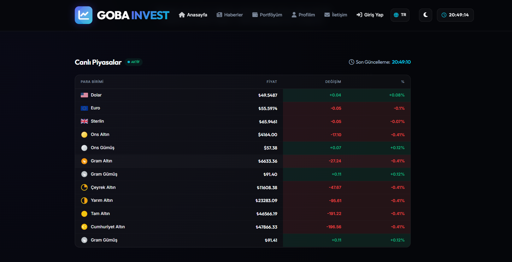
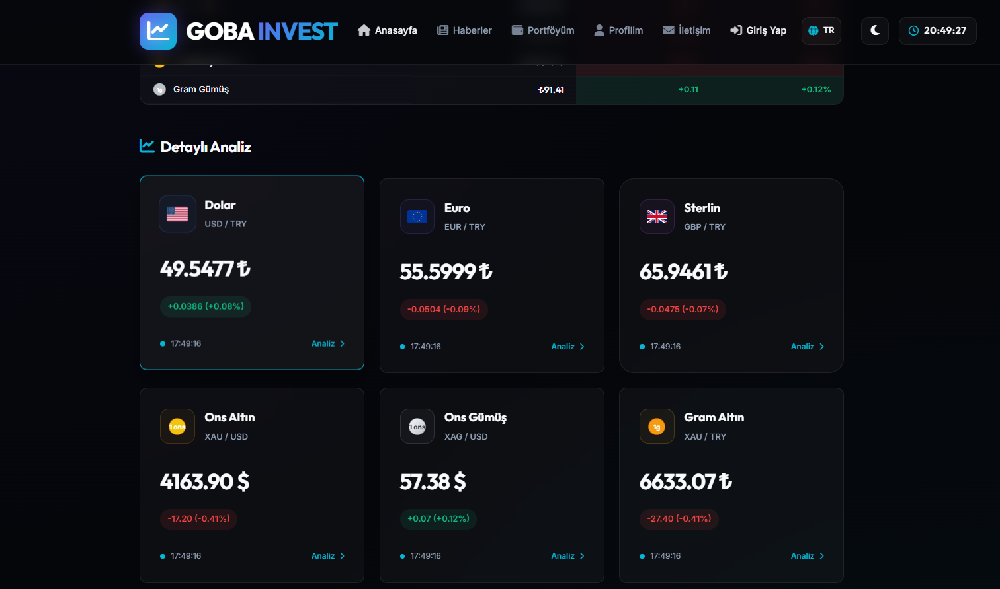
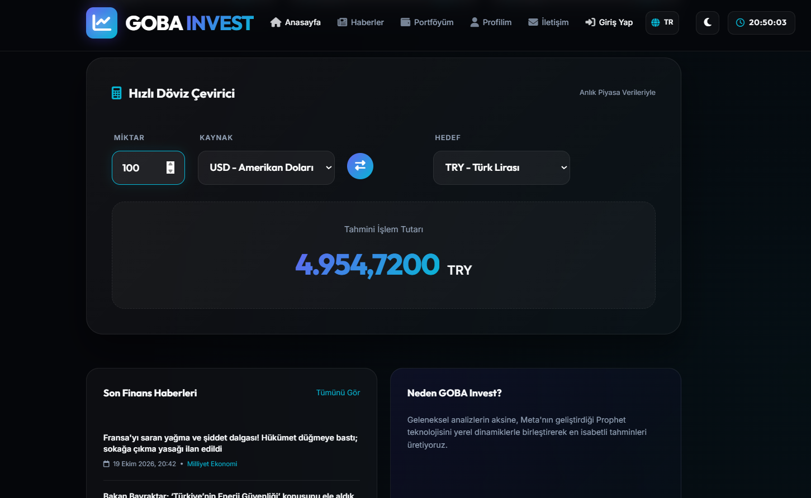
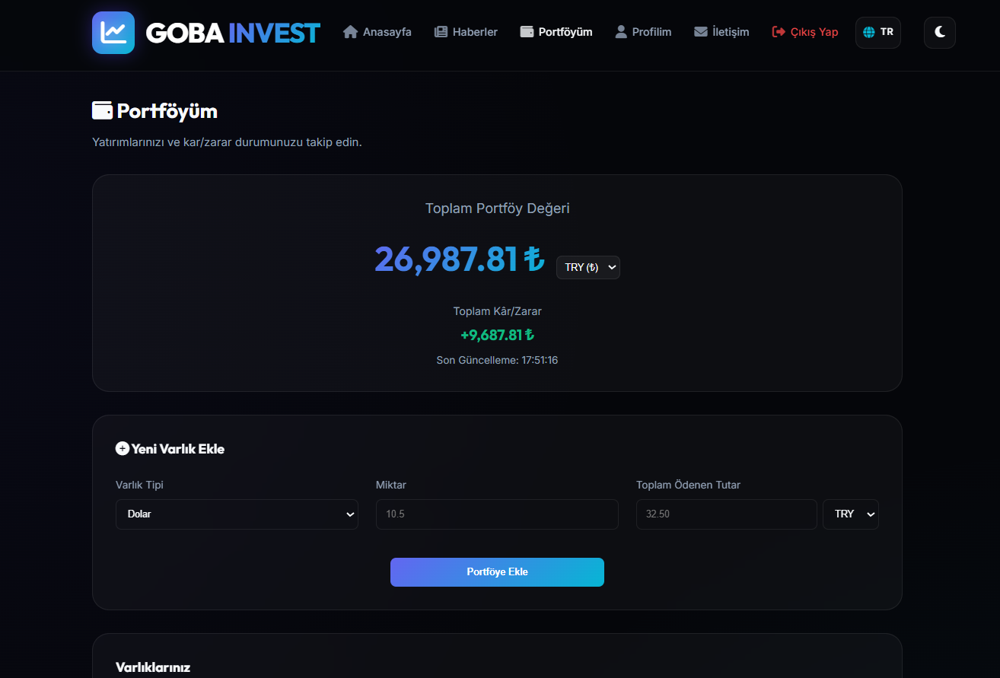
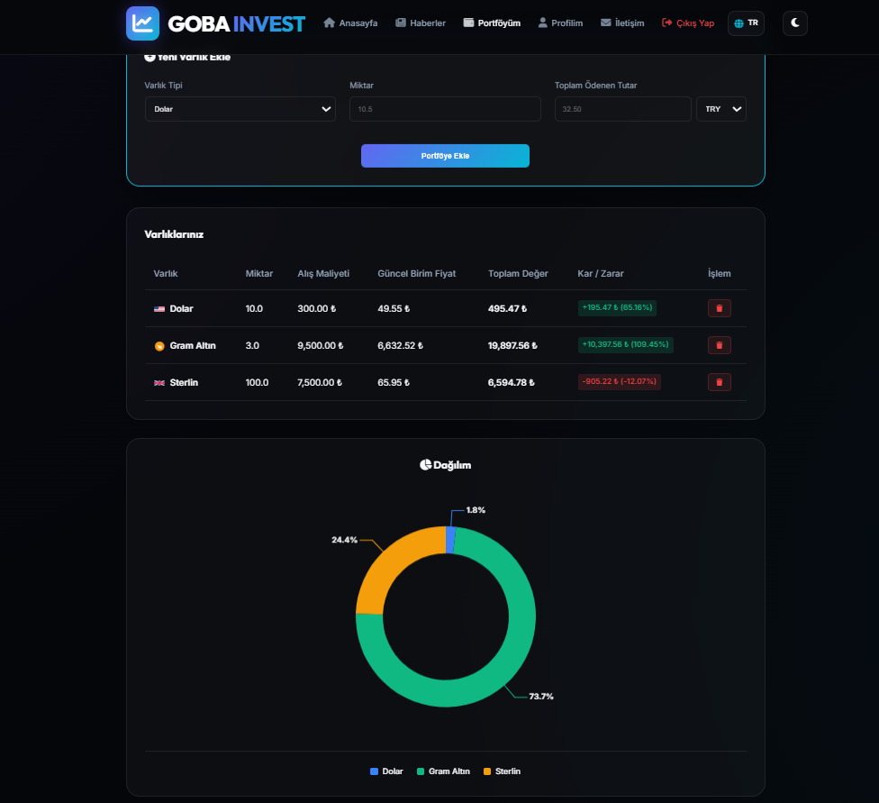
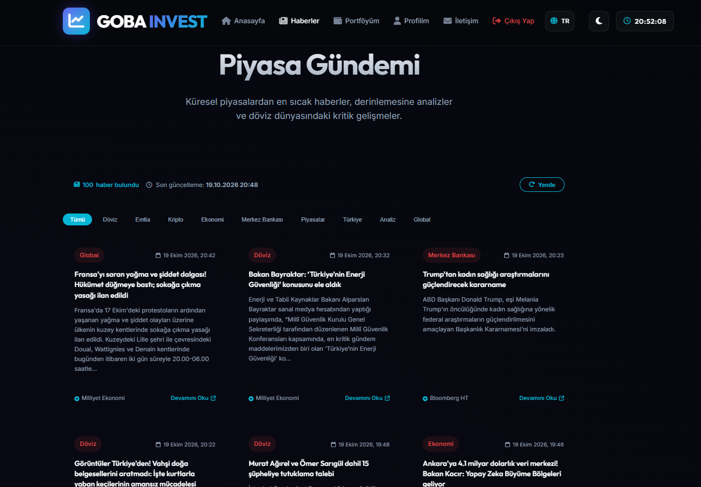
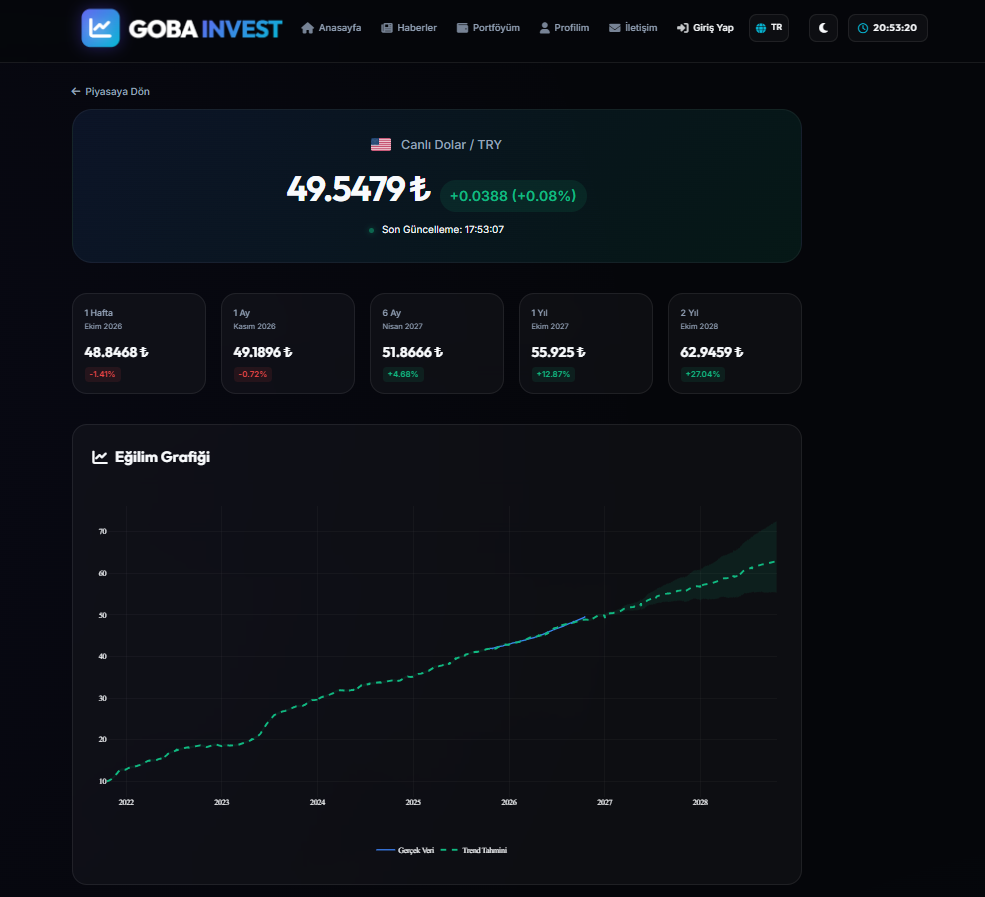
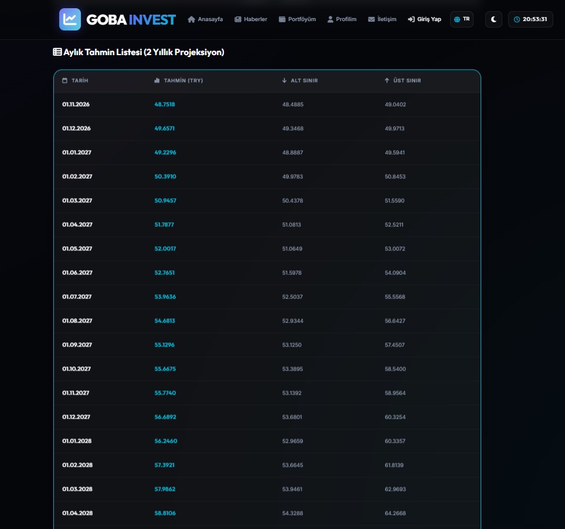
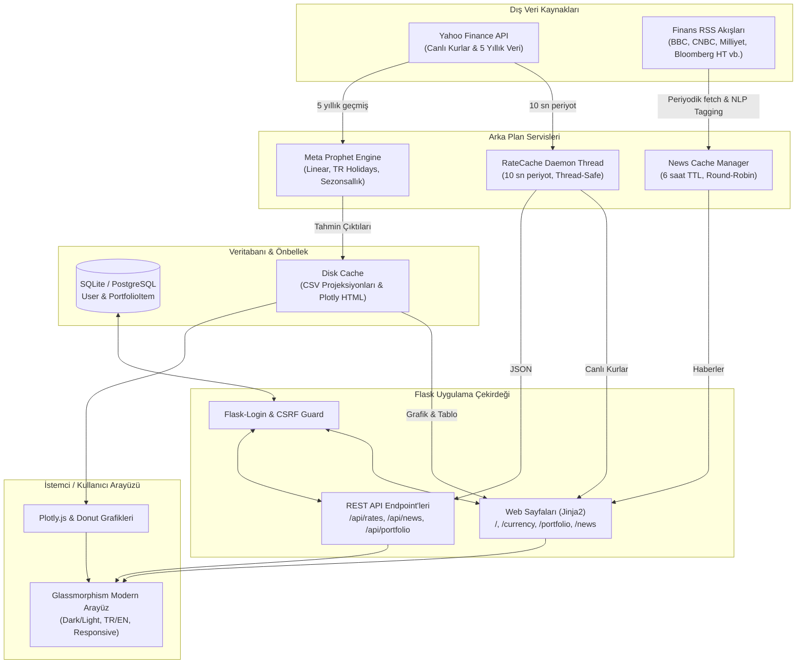

# 🚀 GOBA INVEST — Yapay Zeka Destekli Finansal Analiz & Portföy Yönetim Platformu

<div align="center">

  

  <h3>Geleceğin Finansal Analitiği: Canlı Piyasa Takibi, Meta Prophet Makine Öğrenimi Tahminleri ve Bütünleşik Portföy Yönetimi</h3>

  <p align="center">
    <a href="https://goba-invest.onrender.com" target="_blank">
      
    </a>
    
    
    
    
    
    
  </p>

  <p align="center">
    <a href="#-proje-hakkında">Proje Hakkında</a> •
    <a href="#-temel-özellikler">Özellikler</a> •
    <a href="#-ekran-görüntüleri-ve-arayüz">Ekran Görüntüleri</a> •
    <a href="#-sistem-mimarisi">Mimari</a> •
    <a href="#-teknoloji-yığını">Teknolojiler</a> •
    <a href="#-kurulum-ve-çalıştırma">Kurulum</a> •
    <a href="#-restful-api-referansı">API</a>
  </p>

</div>

---

## 📌 Proje Hakkında

**GOBA INVEST**, döviz piyasaları ve kıymetli madenleri yalnızca izlemekle kalmayıp, **Meta'nın (Facebook) geliştirdiği açık kaynaklı yapay zeka zaman serisi algoritması Prophet** ile 2 yıla kadar modelleyen, kullanıcı bazlı **kâr/zarar ve portföy takibi** sunan, çok kaynaklı haber akışını **doğal dil işleme (NLP) kural motoruyla otomatik etiketleyen** kurumsal seviyede bir finansal analiz ve öngörü platformudur.

Platform; serbest piyasa ve bankacılık dinamiklerini göz önünde bulundurarak Türkiye resmi tatil takvimini zaman serisi modeline dahil eder, 10 saniyelik thread-safe arka plan önbellekleme servisiyle kullanıcılarına sıfır gecikmeli kesintisiz bir deneyim sunar.

---

## ✨ Temel Özellikler

### 1. 🤖 Gelişmiş Yapay Zeka & Makine Öğrenimi Tahmin Motoru (Meta Prophet)
- **Çoklu Ufuk Projeksiyonları:** 1 Hafta, 1 Ay, 6 Ay, 1 Yıl ve 2 Yıllık ileriye dönük kesin trend tahminleri.
- **Yerel Dinamikler & Tatil Entegrasyonu:** `holidays` kütüphanesi üzerinden Türkiye resmi ve dini tatilleri modele tanıtılarak bayram ve tatil dönemlerindeki hacim düşüşleri hesaba katılır.
- **Özel Sezonsallık:** Fourier serileri tabanlı aylık (`monthly`, $N=5$) ve yıllık sezonluk dalgalanma analizi.
- **Daraltılmış Güven Aralıkları:** %50 güven aralığı (`interval_width=0.5`) ve optimize edilmiş değişim noktası hassasiyeti (`changepoint_prior_scale=0.015`) ile aşırı sapmalardan arındırılmış gerçekçi makro trendler.
- **Türev Emtia Modellemesi:** Gram Altın, küresel Ons Altın ($GC=F$) ile $USD/TRY$ kurlarının 5 yıllık günlük kapanışlarının troy ons formülüyle ($(Ons \times Dolar) / 31.1035$) inner-merge edilmesiyle eğitilir.
- **2 Yıllık Aylık Projeksiyon Tablosu:** 25 periyotluk geleceğe dönük ay başı değerleri, alt limit ve üst limit güven sınırlarıyla listelenir.

### 2. 💼 Bütünleşik Portföy & Kâr/Zarar Yönetimi
- **Kullanıcı Hesap Sistemi:** `Flask-Login` ve güvenli PBKDF2 parola şifreleme altyapısıyla kişiselleştirilmiş portföy yönetimi.
- **Çoklu Varlık & Para Birimi Desteği:** Dolar, Euro, Sterlin, Gram/Ons Altın ve Gümüş yatırımlarınızı TL, USD veya EUR maliyet cinsinden kaydedebilme.
- **Anlık Değerleme & P&L Hesabı:** Canlı piyasa kurlarıyla otomatik güncellenen toplam portföy büyüklüğü, net kâr/zarar tutarı ve yüzdesel getiri.
- **İnteraktif Varlık Dağılım Grafiği (Donut Chart):** Portföyünüzün risk ve varlık dağılımını dinamik yüzde dilimleriyle görselleştiren interaktif halka grafik.
- **Anlık İşlem:** AJAX ile sayfa yenilenmeden tek tıkla varlık ekleme ve silme.

### 3. ⚡ Yüksek Performanslı Arka Plan Veri & Cache Mimarisi (`RateCache`)
- **Thread-Safe Daemon Servisi:** Ana web sunucusundan bağımsız çalışan arka plan iş parçacığı (`threading.Thread`), kurları Yahoo Finance üzerinden her 10 saniyede bir günceller.
- **Sıfır API Darboğazı:** Kullanıcı istekleri doğrudan bellek içi önbellekten (`in-memory`) servis edilir; üçüncü taraf API limitlerine veya gecikmelerine takılmaz.
- **Bayat Veri Algılayıcı (`is_stale`):** Ağ kesintisi veya API yanıt vermeme durumlarında veri tazeliğini kontrol ederek güvenli hata izolasyonu sağlar.
- **2 Saatlik Model Cache:** Prophet model eğitimleri ağır matematiksel işlemler gerektirdiğinden, üretilen CSV projeksiyonları ve Plotly grafikleri 2 saatlik TTL ile diskte önbelleklenir.

### 4. 📰 Akıllı Finans Haberleri & Otomatik NLP Etiketleme
- **9 Farklı Küresel & Yerel Kaynak:** Bloomberg HT, BigPara, Milliyet Ekonomi, Investing.com (TR & EN), BBC Business, CNBC Finance, ForexLive ve MarketWatch.
- **Kural Tabanlı Otomatik Kategori Sınıflandırma:** Haber başlığı ve özet metinleri taranarak anında şu kategorilere ayrılır:
  - `Kripto` • `Emtia` • `Merkez Bankası` • `Piyasalar` • `Ekonomi` • `Döviz` • `Türkiye` • `Analiz` • `Global`
- **7 Günlük Denge Dağıtımı:** Haberler round-robin algoritması ile haftanın tüm günlerine dengeli yayılarak zengin bir haber akışı sunulur.
- **6 Saatlik TTL Bellek Önbelleği:** Performanslı erişim ve `?force=1` parametresiyle anlık yenileme desteği.

### 5. 💱 Hızlı Döviz Çevirici & Geniş Varlık Yelpazesi
- **Geniş Ürün Kataloğu:**
  - **Döviz:** USD/TRY, EUR/TRY, GBP/TRY (4 basamak hassasiyet)
  - **Kıymetli Madenler:** Ons Altın ($XAU$), Ons Gümüş ($XAG$), Gram Altın, Gram Gümüş
  - **Sarrafiye Altın Türevleri:** Çeyrek (1.75x), Yarım (3.51x), Tam (7.02x), Cumhuriyet (7.216x)
- **Akıllı Çevirici:** Canlı kurlar üzerinden anında çapraz kur ve TL karşılığı hesaplama, tek tuşla yön değiştirme (Swap).

### 6. 🎨 Premium Glassmorphism UI / UX & Çoklu Dil
- **Gelişmiş Koyu/Aydınlık Tema:** Modern fintek standartlarında neon mavi, zümrüt yeşili ve koyu cam efektli (Glassmorphism) tasarım.
- **Çoklu Dil Desteği (TR / EN):** Tek tıkla Türkçe ve İngilizce dilleri arasında geçiş, grafik içi açıklamaların dinamik dil uyarlaması.
- **İnteraktif Plotly Görselleştirmeleri:** Kullanıcı dostu araç çubuğu; zoom, pan, hover, tarih aralığı filtreleme ve PNG olarak indirme.

---

## 📸 Ekran Görüntüleri ve Arayüz

Platformun güncel ve modern arayüzünden canlı ekran görüntüleri:

<div align="center">

### 1. 📊 Canlı Piyasalar Paneli & Genel Durum

<p><em>Dolar, Euro, Sterlin, Ons, Gram ve tüm Sarrafiye Altın ürünlerinin anlık fiyat, değişim ve durum göstergeleri.</em></p>

<br>

### 2. 💳 Detaylı Analiz Varlık Kartları

<p><em>Piyasa ürünlerinin anlık durum kartları ve tek tıkla yapay zeka analiz sayfasına erişim.</em></p>

<br>

### 3. 💱 Hızlı Döviz Çevirici ve Piyasa Özeti

<p><em>Çift yönlü takas (swap) destekli, canlı fiyatlarla entegre hızlı kur hesaplama aracı.</em></p>

<br>

### 4. 💼 Bütünleşik Portföy Yönetimi ve Varlık Ekleme

<p><em>Kullanıcı bazlı net varlık değeri, toplam kâr/zarar göstergesi ve esnek varlık ekleme formu.</em></p>

<br>

### 5. 🍩 Portföy Varlık Tablosu & Dinamik Dağılım Grafiği

<p><em>Alış maliyeti, güncel birim fiyat, kâr/zarar oranları ve interaktif varlık dağılım (allocation) halka grafiği.</em></p>

<br>

### 6. 📰 Piyasa Gündemi & Çoklu Kategori Haber Akışı

<p><em>9 küresel ve yerel kaynaktan otomatik derlenen, NLP ile etiketlenmiş 100+ finans haberi.</em></p>

<br>

### 7. 📈 Meta Prophet Yapay Zeka Trend Analizi & Ufuk Tahminleri

<p><em>1H, 1A, 6A, 1Y ve 2Y hedef fiyatları, güven aralığı bandı ve interaktif Plotly trend grafiği.</em></p>

<br>

### 8. 📅 2 Yıllık Aylık Projeksiyon Tablosu

<p><em>Gelecek 25 ay boyunca beklenen değerler ile alt ve üst güven sınırlarını içeren detaylı projeksiyon dökümü.</em></p>

</div>

---

## 🏗️ Sistem Mimarisi



---

## 🛠️ Teknoloji Yığını

| Katman | Teknoloji | Açıklama |
| :--- | :--- | :--- |
| **Backend Framework** | **Python 3.11 / Flask** | Yüksek performanslı WSGI web çekirdeği |
| **Yapay Zeka & Tahmin** | **Meta Prophet** | İleri düzey zaman serisi ayrıştırma ve regresyon |
| **Veri Analitiği** | **Pandas, NumPy** | Zaman serisi manipülasyonu, birleştirme ve oran hesapları |
| **Veri Kaynakları** | **yfinance, Requests, Feedparser** | Piyasa verileri ve küresel RSS haber akışları |
| **Veritabanı & ORM** | **Flask-SQLAlchemy, SQLite** | Kullanıcı hesapları ve portföy kayıtları |
| **Kimlik Doğrulama & Güvenlik** | **Flask-Login, Werkzeug, CSRF Guard** | Oturum yönetimi, PBKDF2 parola hashleme, CSRF token kontrolü |
| **Görselleştirme** | **Plotly.js** | Zoom, pan ve hover destekli zengin finans grafikleri |
| **Frontend** | **HTML5, Modern CSS, Vanilla JS** | Özel Glassmorphism tasarım, Dark/Light tema, AJAX polling |
| **İkonografi & Tipografi** | **FontAwesome 6, Inter Font** | Vektörel finansal ikonlar ve modern tipografi |
| **Konteynerizasyon** | **Docker, Docker Compose** | Multi-stage slim container ve gunicorn prodüksiyon sunucusu |

---

## 📂 Proje Dizin Yapısı

```text
currency-exchange-predictor/
├── app.py                      # Ana Flask sunucusu, Prophet eğitimi, Auth ve Route tanımları
├── config.py                   # Ortam değişkenleri ve merkezi konfigürasyon sınıfı
├── rate_cache.py               # Thread-safe arka plan kur güncelleme ve bellek servisi
├── requirements.txt            # Python kütüphane bağımlılıkları
├── Dockerfile                  # Üretime hazır Python 3.11 Docker yapılandırması
├── docker-compose.yml          # Konteyner orkestrasyonu
├── goba.db                     # SQLite veritabanı (User ve PortfolioItem tabloları)
├── app.log                     # Sistem hata ve işlem kayıtları (Logging)
├── docs/
│   └── img/                    # Dokümantasyon ve README için optimize edilmiş ekran görüntüleri
│       ├── 01_live_markets.png
│       ├── 02_detailed_analysis_cards.png
│       ├── 03_currency_converter.png
│       ├── 04_portfolio_management.png
│       ├── 05_portfolio_allocation_chart.png
│       ├── 06_market_news_feed.png
│       ├── 07_ai_trend_forecast.png
│       └── 08_monthly_projection_table.png
├── images/                     # Ekran görüntüleri yedeği
├── static/
│   ├── cache/                  # Üretilen CSV tahminleri ve Plotly interaktif HTML grafikleri
│   ├── main.css                # Glassmorphism stil sistemi, temalar ve animasyonlar
│   ├── main.js                 # AJAX polling, tema/dil değiştirici ve döviz çevirici
│   └── goba_logo.png           # Platform resmi logosu
└── templates/                  # Jinja2 HTML şablonları
    ├── index.html              # Canlı piyasa paneli ve çevirici
    ├── currency.html           # Varlık bazlı detaylı Prophet analiz sayfası
    ├── portfolio.html          # Kullanıcı portföy ve kâr/zarar arayüzü
    ├── news.html               # Piyasa gündemi ve haber modülü
    ├── login.html              # Kullanıcı giriş ekranı
    ├── register.html           # Yeni üye kayıt ekranı
    ├── profile.html            # Kullanıcı profil ve şifre değiştirme
    ├── contact.html            # İletişim formu
    └── privacy.html            # Gizlilik politikası
```

---

## 🔌 RESTful API Referansı

Platform, üçüncü parti entegrasyonlar ve dinamik frontend haberleşmesi için REST API uç noktaları sağlar:

### 1. Canlı Piyasa Kurları
```http
GET /api/rates
```
- **Açıklama:** Desteklenen tüm döviz, ons, gram ve türev altın kurlarını döner.
- **Örnek Yanıt:**
```json
{
  "last_update": "20:49:10",
  "stale": false,
  "rates": [
    {
      "symbol": "USDTRY=X",
      "name": "Dolar",
      "rate": 49.5487,
      "change": 0.04,
      "change_percent": 0.08,
      "currency_symbol": "₺",
      "precision": 4
    }
  ],
  "ticker": [...]
}
```

### 2. Finans Haberleri
```http
GET /api/news?force=0
```
- **Parametreler:** `force=1` (Cache'i atlayarak RSS kaynaklarından anlık taze haber çeker).
- **Örnek Yanıt:**
```json
{
  "count": 100,
  "last_updated": "2026-10-19T20:48:00",
  "articles": [
    {
      "title": "Bakan Bayraktar: 'Türkiye'nin Enerji Güvenliği' konusunu ele aldık",
      "source": "Milliyet Ekonomi",
      "tag": "Döviz",
      "tag_color": "rate-down",
      "link": "https://...",
      "date_tr": "19 Ekim 2026, 20:32"
    }
  ]
}
```

### 3. Portföy Yönetimi (Oturum Gerektirir)
```http
POST /api/portfolio
```
- **Form Verisi:** `symbol`, `amount`, `purchase_price`, `purchase_currency`, `_csrf_token`
- **İşlem:** Kullanıcı portföyüne yeni varlık ekler.

```http
DELETE /api/portfolio
```
- **Form Verisi:** `item_id`, `_csrf_token`
- **İşlem:** Kullanıcı portföyünden varlık siler.

### 4. Şifre Değiştirme
```http
POST /api/change-password
```
- **Form Verisi:** `current_password`, `new_password`, `confirm_password`, `_csrf_token`

---

## 🚀 Kurulum ve Çalıştırma

Projeyi yerel makinenizde çalıştırmak için iki pratik yöntem bulunmaktadır:

### Yöntem 1: Standart Python Ortamı

#### 1. Gereksinimler
- **Python 3.10+** (Python 3.11 önerilir)
- **Git**
- **C++ Derleyici** (Prophet kütüphanesi için gcc/clang veya Windows C++ Build Tools gereklidir)

#### 2. Depoyu Klonlayın
```bash
git clone https://github.com/gorkemcolakk/Goba-Invest---Financial-Analysis-and-Forecasting-Platform-.git
cd Goba-Invest---Financial-Analysis-and-Forecasting-Platform-
```

#### 3. Sanal Ortam Oluşturun ve Aktive Edin
```bash
# Windows
python -m venv venv
venv\Scripts\activate

# Linux / macOS
python3 -m venv venv
source venv/bin/activate
```

#### 4. Bağımlılıkları Yükleyin
```bash
pip install --upgrade pip
pip install -r requirements.txt
```

#### 5. Çevre Değişkenlerini Tanımlayın (`.env`)
Kök dizinde `.env` dosyası oluşturun:
```ini
SECRET_KEY=super-secret-production-key-change-this
DEBUG=True
PORT=5000
DATABASE_URL=sqlite:///goba.db
CACHE_DIR=static/cache
CACHE_TTL_HOURS=2
RATE_UPDATE_INTERVAL=10
LOG_LEVEL=INFO
```

#### 6. Uygulamayı Başlatın
```bash
python app.py
```
Tarayıcınızda `http://127.0.0.1:5000` adresine giderek platformu kullanabilirsiniz.

---

### Yöntem 2: Docker & Docker Compose ile Tek Adımda Kurulum

Docker kullanarak herhangi bir Python veya C++ bağımlılığı kurmadan saniyeler içinde çalıştırabilirsiniz:

```bash
# Konteyneri derleyin ve arka planda çalıştırın
docker compose up -d --build
```
Logları izlemek için:
```bash
docker compose logs -f
```
Durdurmak için:
```bash
docker compose down
```

---

## 🛡️ Güvenlik ve Performans Notları

- **CSRF Koruması:** Tüm `POST` ve `DELETE` istekleri oturum bazlı 256-bit kriptografik CSRF belirteci ile korunur (`secrets.compare_digest` kullanılarak timing attack riskleri önlenir).
- **Parola Koruması:** Kullanıcı parolaları düz metin olarak asla tutulmaz, güvenli `pbkdf2:sha256` algoritması ile tuzlanarak hashlenir.
- **DDoS ve Sunucu Yük Dengeleme:** Ön yüz kur güncelleme isteklerinde `Jitter` (rastgele gecikme payı) uygulanarak tüm istemcilerin aynı anda istek atması (thundering herd problemi) engellenir.
- **Disk I/O Optimizasyonu:** Ağır makine öğrenimi modelleri yalnızca 2 saatte bir güncellenir, böylece disk ve işlemci tüketimi minimuma indirilir.

---

## 🗺️ Gelecek Yol Haritası (Roadmap)

- [ ] **Kripto Varlık Analizleri:** Bitcoin ($BTC$), Ethereum ($ETH$) ve Solana ($SOL$) için Prophet ve LSTM tahmin modelleri.
- [ ] **Fiyat Alarm Sistemi:** Belirlenen kurlara ulaşıldığında kullanıcıya E-posta / Telegram bildirimi gönderme.
- [ ] **Excel / PDF Portföy Raporu:** Kullanıcı portföy hareketlerinin ve kâr/zarar dökümünün tek tıkla dışa aktarılması.
- [ ] **Teknik Göstergeler:** RSI, MACD ve Bollinger Bantlarının Plotly grafiğine entegrasyonu.

---

## 👨‍💻 Geliştirici & İletişim

**Eren Görkem Çolak**
- **GitHub:** [@gorkemcolakk](https://github.com/gorkemcolakk)
- **LinkedIn:** [Eren Görkem Çolak](https://www.linkedin.com/in/eren-g%C3%B6rkem-%C3%A7olak-06104b35a/)
- **Proje Bağlantısı:** [GitHub Repository](https://github.com/gorkemcolakk/Goba-Invest---Financial-Analysis-and-Forecasting-Platform-)
- **Canlı Uygulama:** [goba-invest.onrender.com](https://goba-invest.onrender.com)

---

<div align="center">
  <sub>GOBA INVEST © 2026 — Finansal geleceğinizi yapay zeka ile öngörün.</sub>
</div>
